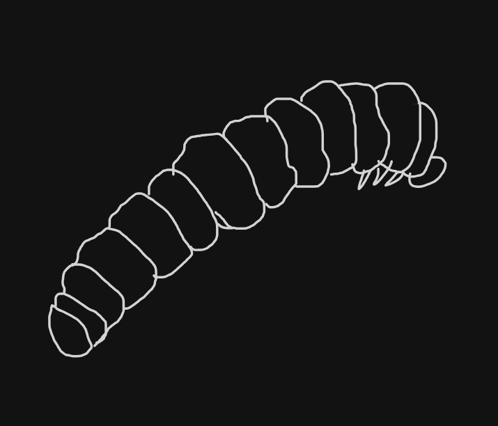

# Bollworm


Bollworm is for people who have an API spec and have been asked for "the API
document, in Word".

It turns an OpenAPI 3.0, 3.1 or 3.2 spec, an OpenRPC 1.x spec, or the gRPC
services in a `.proto` file or FileDescriptorSet into a `.docx` reference
manual: title page, table of contents, introduction, one chapter per tag or
service with a section per call, and a chapter of data models. Headings,
tables and lists use Word's built-in styles, so the navigation pane and the
style gallery work as usual. It is a single static binary.

## Install

```sh
# Arch Linux (AUR), with completions for bash, zsh and fish
yay -S bollworm      # or: paru -S bollworm

# Go 1.27.3 or later
go install github.com/Smiduweorc/bollworm/cmd/bollworm@latest

# Released binary (Linux and macOS, amd64 and arm64), checksum verified
curl -sSfL https://raw.githubusercontent.com/Smiduweorc/bollworm/master/install.sh | sh
```

Windows binaries, `.deb` and `.rpm` packages are attached to each
[GitHub release](https://github.com/Smiduweorc/bollworm/releases). CI runs the
tests on Linux, macOS and Windows. The [`PKGBUILD`](./PKGBUILD) here is the one
published to the AUR; `makepkg -si` in the repository root builds it too.

## Quick start

Two public APIs whose specs need no account: the AUR's HTTP API (OpenAPI) and
Ethereum's JSON-RPC API (OpenRPC).

```sh
curl -sSfL https://aur.archlinux.org/rpc/openapi.json -o aur.json
curl -sSfL https://raw.githubusercontent.com/ethereum/execution-apis/assembled-spec/openrpc.json -o ethereum.json

bollworm render aur.json -o aur.docx --link-base https://aur.archlinux.org/
bollworm render ethereum.json -o ethereum.docx
```

Nothing is printed on success. Open the files in Word; when it asks whether
to update the fields in the document, say yes, and the contents get their
page numbers.

Other inputs:

```sh
# gRPC from a .proto file; -I names the import root, as with protoc
bollworm render testdata/proto/library/v1/library.proto -I testdata/proto -o library.docx

# gRPC from a FileDescriptorSet that buf or protoc has built
buf build -o api.binpb && bollworm render api.binpb -o api.docx

# A spec whose $refs point at https URLs (files are always followed)
bollworm render testdata/strava.json -o strava.docx --allow-remote-refs

# stdin to stdout
curl -sSfL https://aur.archlinux.org/rpc/openapi.json | bollworm render - -o - > aur.docx
```

## Usage

```
bollworm render <spec> -o <file.docx> [--force] [--paper a4|letter] [--allow-remote-refs]
    [--proto-path <dir>]... [--include-imports] [--link-base <url>] [--toc-depth 1|2|3] [--reference-doc <file.docx>] [--strict]
```

The spec is an OpenAPI or OpenRPC document (YAML or JSON), a `.proto` file,
or a binary FileDescriptorSet (`.binpb`, `.pb`, `.desc`, `.protoset`).

| Flag | Default | What it does |
| --- | --- | --- |
| `-o`, `--output` | required | File to write, or `-` for stdout (refused on a terminal) |
| `--force` | off | Replace an existing output file |
| `--paper` | `a4` | `a4` or `letter` |
| `--toc-depth` | `2` | Contents depth: 1 chapters, 2 calls and models, 3 their parts |
| `--reference-doc` | none | Take the styles from your own `.docx` |
| `--strict` | off | Fail and write nothing if there are warnings |
| `--link-base` | none | Absolute http(s) URL to resolve relative links against |
| `--allow-remote-refs` | off | Fetch `$ref`s to https URLs (OpenAPI, OpenRPC) |
| `-I`, `--proto-path` | file's directory | Where to find `.proto` imports; repeatable |
| `--include-imports` | off | Protobuf: also describe the services of imported files |

`--force` writes to a temporary file and renames it into place, so a failed
run leaves the old file as it was. Bollworm never writes over its own input,
even with `--force`.

`--reference-doc` matches Word's built-in style names (`Heading1`, `Title`,
`TOC1`, ...) and bollworm's own `Code`, `CodeChar`, `Endpoint`, `Label` and
`TableText`. A style the file lacks keeps bollworm's look, with a warning.

Without `--link-base`, a relative link is printed after its text, with a
warning. The server URL is not used as the base, because an API's host is
often not where its documentation lives.

`--proto-path` directories are searched in order; without one, imports are
looked up next to the file (the working directory for stdin).
`google/protobuf/*.proto` are built in; anything else, including
`google/api/annotations.proto`, must be on a proto path. `--proto-path` is
refused for input that is not a `.proto` file.

| Exit code | Meaning |
| --- | --- |
| 0 | The document was written. |
| 1 | The spec could not be read or rendered, the file could not be written, or `--strict` found warnings. Every problem is on stderr, one per line, with its line in the spec (`file.proto:12:3:` for a `.proto`). |
| 2 | The command line was wrong. |

## Not included

- A documentation website. Use Redoc, Scalar, Swagger UI or the OpenRPC
  playground. Bollworm writes a file you can attach to an email.
- Swagger 2.0. It is refused; convert it with `swagger2openapi` first.
- Theme, font or colour flags. Change the styles in Word, or pass
  `--reference-doc`.
- PDF. Word and LibreOffice both export the `.docx` to PDF.
- Talking to a live server. Bollworm does not call `rpc.discover` or use gRPC
  server reflection; save the spec to a file first. For gRPC,
  `grpcurl -plaintext -protoset-out api.binpb localhost:50051 describe`
  writes a set bollworm reads, usually without the comments.
- A typed client. [dung beetle](https://github.com/Smiduweorc/dung-beetle-template)
  builds one from the same specs.

## Documentation

- [What ends up in the document](./docs/output.md)
- [Continuous integration](./docs/ci.md)
- [Creative workflows](./docs/creative-workflows.md)
- [Known quirks](./docs/quirks.md)
- [Development](./docs/development.md)

## Licence

MIT. See [LICENSE](./LICENSE).

## Lore

A `.docx` file is a zip of XML documents, an archive that hides its workings
inside a single file. A bollworm bores into a cotton boll or a fruit and
does all its work on the inside, out of sight. Hence the name.

Bollworm was [inspired by go-openapi-converter](https://github.com/weisurya/go-openapi-converter).
We made our own because that one uses an older version of Go, did not seem
to parse some newer schema versions correctly, does not support `$ref`, and
depends on `unioffice`, whose AGPL licence may not suit everyone. This is by
no means throwing dirt at it, just us making our own thing.
