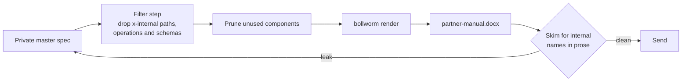
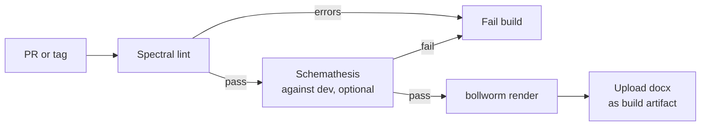
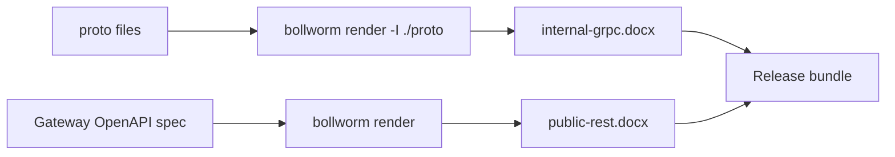
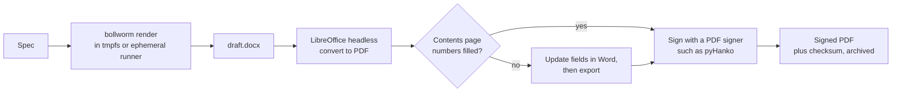

# Creative ways to use bollworm, based on what I hear from people in corporate

Bollworm turns one OpenAPI, OpenRPC or gRPC definition into one `.docx`. It
reads a file or stdin, writes a file or stdout, and only goes to the network
when you pass `--allow-remote-refs`. That makes it easy to put between other
tools in a pipeline.

These are workflows that come up when people have to hand an API manual to
someone else: a partner, an auditor, a customer, a regulator. Bollworm does one
job, so each workflow pairs it with tools that do the others. Check the flags of
those tools against the versions you install.

- [Sanitized manual for an external partner](#1-sanitized-manual-for-an-external-partner)
- [Lint and test before the manual is built](#2-lint-and-test-before-the-manual-is-built)
- [A gRPC manual and a REST manual, shipped together](#3-a-grpc-manual-and-a-rest-manual-shipped-together)
- [A signed PDF for regulated environments](#4-a-signed-pdf-for-regulated-environments)

---

## 1. Sanitized manual for an external partner

Your master spec has admin routes, experimental features and employee-only
endpoints. A partner needs an offline reference that shows only the public
surface.

Bollworm renders everything it is given, so redact first and render the result.



```sh
# Redocly's filter-out decorator (configured in redocly.yaml) plus pruning
redocly bundle master-spec.yaml --remove-unused-components -o public-spec.yaml
bollworm render public-spec.yaml -o partner-manual.docx
```

`openapi-filter` does the same job if you prefer it.

Two things to watch:

- Filtering paths is not enough. Schemas used only by internal endpoints stay in
  `components` and appear in the data models chapter unless you prune them.
- Descriptions, examples and tag text are copied as written. Read the output
  once for internal system names.

Putting the filter in CI means nobody has to render the master spec by hand.

---

## 2. Lint and test before the manual is built

Some teams will not hand out documentation for an API that breaks their own
style guide. Bollworm is not a linter, so the check goes in front of it.

[Spectral](https://github.com/stoplightio/spectral) is quick and deterministic.
[Schemathesis](https://github.com/schemathesis/schemathesis) is an optional
second gate that tests a running environment against the spec. It needs a
deployed service, so add it when the manual is a contractual deliverable.



```yaml
jobs:
  docs:
    runs-on: ubuntu-latest
    steps:
      - uses: actions/checkout@v4
      - name: Lint
        run: npx @stoplight/spectral-cli lint openapi.yaml --fail-severity=error
      - name: Install bollworm
        run: curl -sSfL https://raw.githubusercontent.com/Smiduweorc/bollworm/master/install.sh | sh
      - name: Render
        run: bollworm render openapi.yaml -o api-reference.docx --force
      - uses: actions/upload-artifact@v4
        with:
          name: api-reference
          path: api-reference.docx
```

Attach the `.docx` to a release instead of uploading it as an artifact if you
want the manual to be versioned alongside the tag.

---

## 3. A gRPC manual and a REST manual, shipped together

A polyglot backend often has `.proto` files for internal services and an OpenAPI
spec for the public gateway. Bollworm takes one spec per run, so render each and
ship the two files side by side with clear names.



```sh
bollworm render ./proto/v1/billing.proto -I ./proto -o internal-grpc.docx
bollworm render gateway-spec.json -o public-rest.docx
```

If you have a running gRPC server but no `.proto` files, `grpcurl` can write a
descriptor set from reflection, and bollworm reads that:

```sh
grpcurl -plaintext -protoset-out api.binpb localhost:50051 describe
bollworm render api.binpb -o api.docx
```

Combining the two into a single file is best done in Word (Insert, Object, Text
from File), where the styles survive and you can fix the contents page. Tools
that rebuild a document from their own model, such as `pandoc a.docx b.docx`,
flatten bollworm's Word styles and leave two title pages and two tables of
contents.

---

## 4. A signed PDF for regulated environments

In finance and healthcare a manual often has to leave the building as a flat,
checksummed, signed file rather than an editable one. Bollworm writes `.docx`
and leaves PDF to Word or LibreOffice, so headless LibreOffice is the bridge.



```sh
work=$(mktemp -d)
bollworm render internal-spec.yaml -o "$work/draft.docx"
libreoffice --headless --convert-to pdf "$work/draft.docx" --outdir ./distribution
sha256sum distribution/draft.pdf > distribution/draft.pdf.sha256
rm -rf "$work"
```

Notes:

- Word asks to update fields when it opens bollworm's output so the table of
  contents gets page numbers. Check that the PDF's contents page is populated.
- OpenSSL can make a detached signature or a timestamp request, which suits
  integrity checks. A signature embedded in the PDF that Acrobat recognises needs
  a PDF signer such as pyHanko.
- Deleting a file does not securely erase it. If the intermediate `.docx` is
  sensitive, render in a tmpfs or on an ephemeral CI runner.

---

## Have a workflow of your own?

If you pair bollworm with something not listed here, open an issue or a pull
request and add it.
